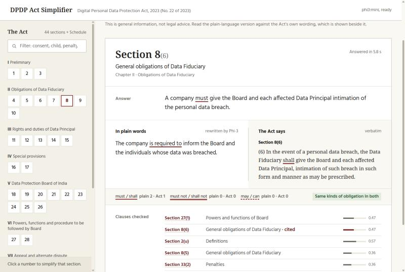
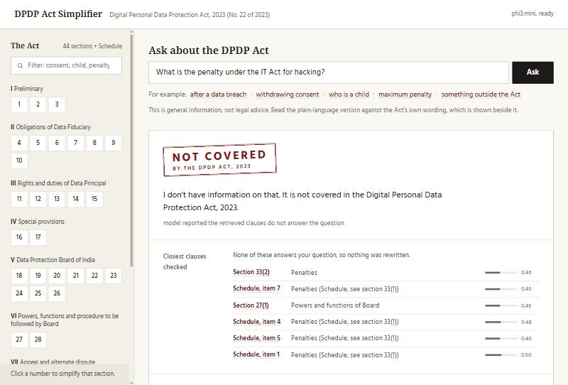
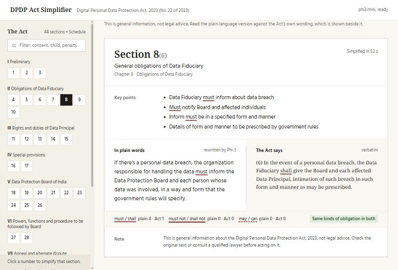
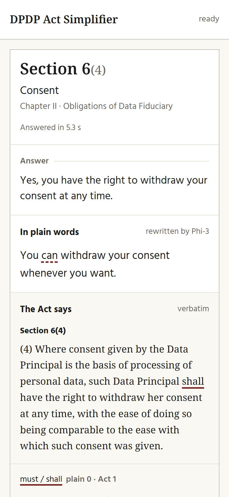

# DPDP Act Simplifier

**CSL374 Microservice Based Applications · Project 11: Legal/Policy Document Simplifier**

Ask questions about India's **Digital Personal Data Protection Act, 2023** in everyday words. You get a
plain-language answer, the **exact clause it rests on** (copied verbatim, never generated), the citation
(e.g. *Section 8(6)*), and a "general information, not legal advice" disclaimer. Questions the Act does
not cover get a graceful *"I don't have information on that. It is not covered in the Digital Personal
Data Protection Act, 2023."*

Everything runs locally: **Phi-3-mini via Ollama**, `all-MiniLM-L6-v2` embeddings, FAISS, LangChain, FastAPI.

> Team: Aditya Ruhil (23CSU015), Aditya Chahar (23CSU014), Anmole (23CSU033) · Guide: Prerna Singal, Assistant Professor · CSL374, 7th Semester 2026, The NorthCap University, Gurugram · Source: the official Gazette of India PDF of the Act (MeitY)
>
> Project report: [`docs/deliverables/DPDP_Simplifier_Project_Report.pdf`](docs/deliverables/DPDP_Simplifier_Project_Report.pdf) (Word version alongside)



---

## Contents
1. [Architecture](#architecture)
2. [Setup](#setup)
3. [API](#api)
4. [Sample outputs (real)](#sample-outputs-real)
5. [Failure cases and graceful fallback](#failure-cases-and-graceful-fallback)
6. [Evaluation](#evaluation)
7. [Web frontend](#web-frontend)
8. [5-minute demo script](#5-minute-demo-script)
9. [Definition of Done checklist](#definition-of-done-checklist)
10. [Project layout](#project-layout)

---

## Architecture

```mermaid
flowchart LR
    PDF[Gazette PDF<br/>DPDP Act 2023] --> X[pdfplumber<br/>word coordinates]
    X --> C[Clean<br/>drop header, Hindi masthead,<br/>margin cross-refs, signature]
    C --> S[Structure-aware chunking<br/>Chapter → Section → sub-section / clause<br/>+ Schedule table rows]
    S --> E[all-MiniLM-L6-v2<br/>embeddings, CPU]
    E --> F[(FAISS<br/>inner product = cosine)]
    S --> B[(BM25)]
    Q[User question] --> R{Hybrid retrieve<br/>dense + BM25, RRF, top-6}
    F --> R
    B --> R
    R -->|best cosine < 0.25| FB[Fallback:<br/>not covered]
    R --> P[LangChain prompt<br/>strict, JSON, temp 0.1]
    P --> L[Phi-3-mini<br/>Ollama]
    L -->|in_scope = false| FB
    L --> A[Attribute citation<br/>answer ↔ clause similarity]
    A --> O[answer · plain_language ·<br/>verbatim clause · sections · disclaimer]
    O --> API[FastAPI<br/>/ask /simplify /sections /health]
    FB --> API
    API --> UI[Web frontend<br/>+ Postman]
```



Plain-text version: `PDF → clean → chunk by section → embed (MiniLM) → FAISS (+BM25) → retrieve → Phi-3-mini → FastAPI → frontend / Postman`

**Design decisions**

| Decision | Why |
|---|---|
| Chunk by the Act's own structure (202 chunks: sub-sections, definition clauses, Schedule rows) | Answers can cite `Section 8(6)`, not "chunk 37". Over-long parts (s.7, s.17(1), s.40(2)) are split by clause, each keeping its lead-in sentence so it still reads as law. |
| Margin notes become section titles | The Gazette prints titles in the margin (left on odd pages, right on even). Reading word x-positions separates them from body text. |
| Verbatim clause is copied from the index, never generated | The "original" cannot be hallucinated. |
| Hybrid retrieval (dense + BM25, reciprocal-rank fusion), k = 6 | On the **dev** set, recall@6 went from 5/8 (dense only) to 6/8. Dense handles paraphrase; BM25 handles exact legal terms. |
| Two-stage fallback | (1) similarity gate, cosine < 0.25: no LLM call, under 1 s. (2) Phi-3 must set `in_scope:false` when the clauses do not answer. A threshold alone could not separate in/out of scope (an IPC question scored 0.52). |
| Citation attribution by embedding similarity | Phi-3-mini tends to cite every clause it was shown. The answer is embedded and matched to the retrieved clauses; the best match is the primary citation. |
| Temperature 0.1, seed 42, explicit modality rules in the prompt | Keep "shall / shall not / may" intact and make runs repeatable. |
| Tried and rejected: HyDE query expansion | Dev recall@6 fell from 6/8 to 5/8. Kept in code behind `USE_HYDE=1`, off by default. |

---

## Setup

Tested on Windows 11, Python 3.11, RTX 4050 6 GB, Ollama 0.40.

```powershell
ollama pull phi3:mini
```

```powershell
py -3.11 -m venv .venv
```

```powershell
.\.venv\Scripts\python -m pip install -r requirements.txt
```

> If your project path is very long (Windows' 260-character limit), torch fails to load its DLLs
> (`WinError 206`). Put the venv in a short path such as `C:\venvs\dpdp` instead.

Build the index (downloads the PDF if missing, prints sample chunks), then run the smoke test, the tests and the API:

```powershell
.\.venv\Scripts\python -m src.ingest
```

```powershell
.\.venv\Scripts\python -m scripts.smoke_test_slm
```

```powershell
.\.venv\Scripts\python -m pytest -q
```

```powershell
.\.venv\Scripts\python -m uvicorn src.api:app --port 8000
```

Open **http://localhost:8000** (web frontend) or **http://localhost:8000/docs** (Swagger).

**Docker** (Ollama stays on the host):

```powershell
docker build -t dpdp-simplifier .
```

```powershell
docker run --rm -p 8000:8000 --add-host=host.docker.internal:host-gateway dpdp-simplifier
```

> The Dockerfile was written but **not built on the development machine** (Docker is not installed there). Build it once before the demo.

All settings are environment variables (see `src/config.py`): `OLLAMA_BASE_URL`, `LLM_MODEL`, `TOP_K`, `SIM_THRESHOLD`, `LLM_TEMPERATURE`, `USE_HYDE`.

---

## API

| Method | Path | Body | Returns |
|---|---|---|---|
| GET | `/health` | | status, Ollama reachable, model pulled, index loaded, chunk count |
| GET | `/sections` | | 44 sections + Schedule: number, title, chapter, sub-section citations |
| POST | `/ask` | `{"question": "..."}` | `answer, plain_language, original_clause, sections, disclaimer, fallback, fallback_reason, retrieved[], latency_s` |
| POST | `/simplify` | `{"section": "8(6)"}` (also `"8"`, `"Section 17(1)(a)"`, `"Schedule"`) | `section, title, original_clause, plain_language, key_points, disclaimer, latency_s` |

Errors: `422` invalid input (question under 3 characters), `404` unknown section (`"Section 99 does not exist. The Act has sections 1-44."`), `503` when Ollama is down (with a recovery hint).

**Postman:** import [`postman/DPDP_Simplifier.postman_collection.json`](postman/DPDP_Simplifier.postman_collection.json): 9 requests with test scripts (health, sections, three in-scope questions, the IT Act fallback, a 422, simplify 8(6), a 404). `python -m scripts.replay_postman` sends the same 9 requests to the running API and applies the same checks (last run: 30/30 passed, `evidence/api/postman_replay.json`). Raw responses from the same calls made with curl are in [`evidence/api/`](evidence/api/).

---

## Sample outputs (real)

Captured from `POST /ask` on the development laptop (`evidence/api/ask_samples.jsonl`). The disclaimer and `retrieved` list are omitted here for space.

**1. "Can I withdraw my consent at any time?"** → `Section 6(4)`, 9.96 s (first call, includes model load)
```json
{
  "answer": "Yes, you have the right to withdraw your consent at any time.",
  "plain_language": "You can withdraw your consent whenever you want.",
  "original_clause": "[Section 6(4)] (4) Where consent given by the Data Principal is the basis of processing of personal data, such Data Principal shall have the right to withdraw her consent at any time, with the ease of doing so being comparable to the ease with which such consent was given.",
  "sections": ["Section 6(4)"],
  "fallback": false
}
```
*Spot check:* correct clause, meaning kept. The rewrite drops the "as easy as giving it" condition; the verbatim clause beside it carries it.

**2. "Who counts as a child under this law?"** → `Section 2(f)`, 2.84 s
```json
{
  "answer": "A child is defined as an individual who has not completed the age of eighteen years.",
  "plain_language": "Under this law, a child is anyone under eighteen years of age.",
  "original_clause": "[Section 2(f)] (f) \"child\" means an individual who has not completed the age of eighteen years;",
  "sections": ["Section 2(f)"],
  "fallback": false
}
```

**3. "What is the maximum penalty for a Data Fiduciary that fails to prevent a data breach?"** → `Schedule, item 1`, 4.43 s
```json
{
  "answer": "The maximum penalty for a Data Fiduciary that fails to prevent a data breach is two hundred and fifty crore rupees.",
  "plain_language": "If a Data Fiduciary doesn't take reasonable steps to protect personal data, they could be fined up to two hundred and fifty crore rupees.",
  "original_clause": "[Schedule, item 1] 1. Breach: Breach in observing the obligation of Data Fiduciary to take reasonable security safeguards to prevent personal data breach under sub-section (5) of section 8.\nPenalty: May extend to two hundred and fifty crore rupees.",
  "sections": ["Schedule, item 1"],
  "fallback": false
}
```

**Simplify:** `POST /simplify {"section": "8(6)"}` → *"If there's a personal data breach, the organization responsible for handling the data must inform the Data Protection Board and each person whose data was involved, in a way and form that the government rules will specify."* (`evidence/api/simplify_8_6.json`)

---

## Failure cases and graceful fallback

**A. Out of scope, handled gracefully.** *"What is the penalty under the IT Act for hacking?"* This is a hard case: the Act does mention the IT Act (s.44 amends it) and has a penalty Schedule, so retrieval scores are high (0.46). The similarity gate passes it, but Phi-3 reports the clauses do not answer it:
```json
{"answer": "I don't have information on that. It is not covered in the Digital Personal Data Protection Act, 2023.",
 "sections": [], "fallback": true,
 "fallback_reason": "model reported the retrieved clauses do not answer the question"}
```
Clearly unrelated questions ("GST rate on restaurant food", score 0.20) are stopped by the gate in under 1 s with no model call.



**B. Documented failure: retrieval miss → wrong refusal (test T9).** *"Can my personal data be sent to other countries?"* The answer is Section 16(1) (*"The Central Government may, by notification, restrict the transfer of personal data ... outside India"*), but the question shares almost no words with "transfer ... outside India", and Section 16 was not in the top 6. Phi-3 then correctly saw the retrieved clauses did not answer and returned the fallback. The failure is safe (no invented answer) but unhelpful. Mitigations tried: HyDE expansion (rejected; it lowered dev recall). Asking with the Act's wording ("transfer of personal data outside India") retrieves 16(1).

**C. Documented failure: meaning flip in a long rewrite.** Simplifying the *whole* of Section 6 once produced *"...cannot be withdrawn easily"*, which reverses 6(4). Details: [`evidence/failure_simplify_section6.md`](evidence/failure_simplify_section6.md). This is why the verbatim clause is always shown beside the rewrite, and why simplifying a sub-section (`6(4)`) is safer than a whole section.

---

## Evaluation

`eval/questions.json`: **10 held-out in-scope questions** (expected section + key facts) and **3 out-of-scope** questions, written from the Act **before any tuning**. Prompts, k and the threshold were chosen only on `eval/dev_questions.json` (8 + 6 different questions). Each answer was then read against the Act by hand (`eval/manual_review.json`).

| Metric | Result |
|---|---|
| Retrieval hit (expected clause in top-6) | **9/10** |
| Cited the expected clause | **8/10** |
| Automatic key-fact check | **7/10** |
| **Strictly correct** (right clause cited + facts + meaning kept, manual review) | **6/10** |
| Out-of-scope → graceful fallback | **3/3** |
| Mean latency | 4.3 s |

**Honest status against DoD 3 (≥ 8/10): not met, 6/10 strict, 7/10 automatic.** Misses: T2 rewrite adds "promptly" (the Act sets no timing); T5 correct content but attributed to 6(10) instead of 5(1); T8 lists a right (grievance redressal) as a duty; T9 retrieval miss (above). Full table: [`eval/results.md`](eval/results.md); raw answers: `eval/results_run1.json`.

Re-run: `python -m eval.run_eval` (live) or `python -m eval.run_eval --report-only eval/results_run1.json` (re-score the saved run). A manual verdict only applies while the output is exactly the reviewed text; any change shows "unreviewed".

---

## Web frontend

Served by the same FastAPI app at `/` (`frontend/`, plain HTML/CSS/JS, fonts self-hosted, works offline).

- **Ask** box with example questions, including one outside the Act.
- **The Act** rail: all 44 sections and the Schedule as a numbered grid by chapter, with a title filter. Click any section to simplify it; the section cited by the latest answer gets a maroon border.
- **Answer view:** the citation is the headline; the plain words and the verbatim clause sit side by side on one centre rule.
- **Look:** a plain printed-reference style (warm paper, black ink, serif headings, one maroon accent, no shadows or animations), chosen so the tool doesn't read as a generic AI app.
- **Attest:** every *must / shall*, *must not / shall not* and *may / can* is underlined (solid / double / dashed) in both columns. Hover or focus one and every mark of the same force lights up in both, so a changed obligation is easy to spot. An obligation ledger counts them per column. It is a coarse aid, not a verifier (see failure C).
- Loading steps with elapsed time and Cancel, a NOT COVERED stamp for fallbacks, clear 503/404/422 errors, deep links (`#q=...`, `#s=8(6)`), and a stacked mobile layout.

Designed with the Impeccable skill: product record in `PRODUCT.md`, direction contract in `.impeccable/surfaces/frontend-index-html.md`, design system in `DESIGN.md`.

| Simplify a section | Mobile |
|---|---|
|  |  |

---

## 5-minute demo script

| Time | Do | Say |
|---|---|---|
| 0:00–0:40 | Show the README architecture diagram. | "Gazette PDF, chunked by section, MiniLM + FAISS + BM25, Phi-3-mini on Ollama, FastAPI." |
| 0:40–1:20 | Terminal: `python -m src.ingest` output (`evidence/dod1_ingest_output.txt`), then `python -m scripts.smoke_test_slm`. | "44 sections, 202 chunks with section numbers. Phi-3 loads locally and passes the smoke test." |
| 1:20–2:50 | Browser `localhost:8000`: click **After a data breach**, then **Who is a child**, then **Maximum penalty**. Hover *shall* in the Act column. | "Citation as the headline, plain words beside the exact clause, modal verbs matched across both." |
| 2:50–3:30 | Click **Outside the Act** (IT Act question). | "The Act mentions the IT Act, so retrieval scores are high, but the model sees no answer: graceful NOT COVERED, no invented citation." |
| 3:30–4:10 | Postman: run the collection (or Swagger `/docs`): `/ask`, `/simplify 8(6)`, 404 for `99`. | "Same microservice, tested with request/response checks." |
| 4:10–5:00 | Open `eval/results.md`. | "Held-out test: 9/10 retrieval, 3/3 fallbacks, 6/10 strictly correct. Here's one failure (T9) and why." |

---

## Definition of Done checklist

| DoD | Marks | Evidence | Status |
|---|---|---|---|
| 1. Data pipeline loads, cleans, chunks with section numbers | 3 | `src/ingest.py`, `evidence/dod1_ingest_output.txt`, `data/processed/chunks.json`, tests in `tests/test_pipeline.py` | Done |
| 2. Phi-3-mini via Ollama answers a basic test prompt | 3 | `scripts/smoke_test_slm.py`, `evidence/dod2_slm_smoke_test.json` (3/3 passed) | Done |
| 3. ≥ 8/10 correct clause + meaning-preserving rewrite | 5 | `eval/results.md` | **6/10 strict, 7/10 automatic: below target** |
| 4. FastAPI endpoint tested in Postman | 5 | `src/api.py`, `postman/` collection, `evidence/api/postman_replay.json` | Done: 9 requests, 30/30 checks passed (`python -m scripts.replay_postman`) |
| 5. README + 5-minute demo + failure case with fallback | 4 | this file (demo script above), `docs/screenshots/`, `evidence/failure_simplify_section6.md` | Done |

---

## Project layout

```
src/        config.py · ingest.py (PDF → chunks → FAISS) · embeddings.py · rag.py (retrieve, answer, simplify) · api.py (FastAPI)
scripts/    smoke_test_slm.py (DoD 2) · dev_check.py (dev-set run)
eval/       questions.json (test) · dev_questions.json · run_eval.py · manual_review.json · results.md/.csv/.json · results_run1.json
tests/      test_pipeline.py (13 tests, no Ollama needed)
frontend/   index.html · styles.css · app.js · fonts/
postman/    DPDP_Simplifier.postman_collection.json
evidence/   ingestion output · SLM smoke test · API responses · failure write-up
data/raw/   dpdp_act_2023.pdf (Gazette of India, MeitY)
```

*General information about the DPDP Act, 2023, not legal advice.*
